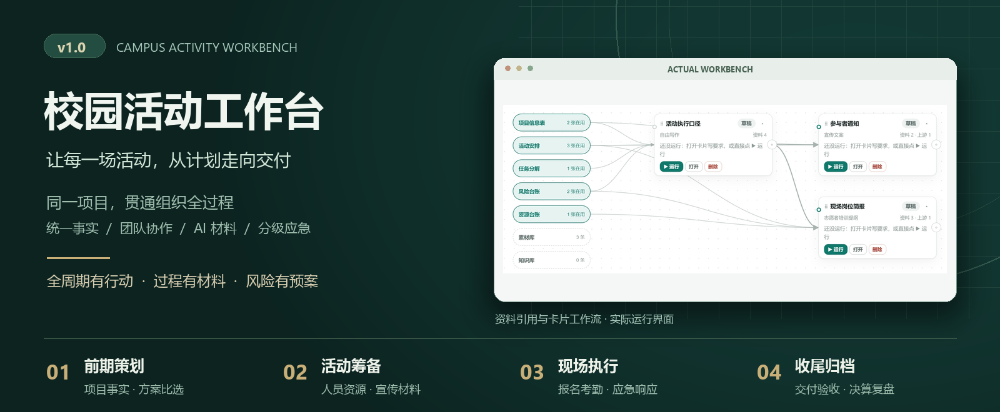
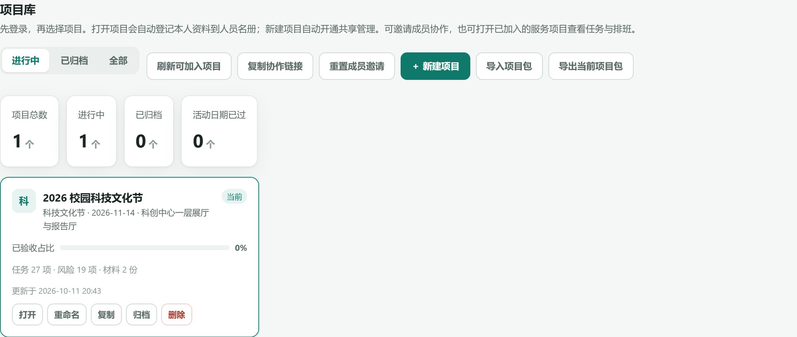
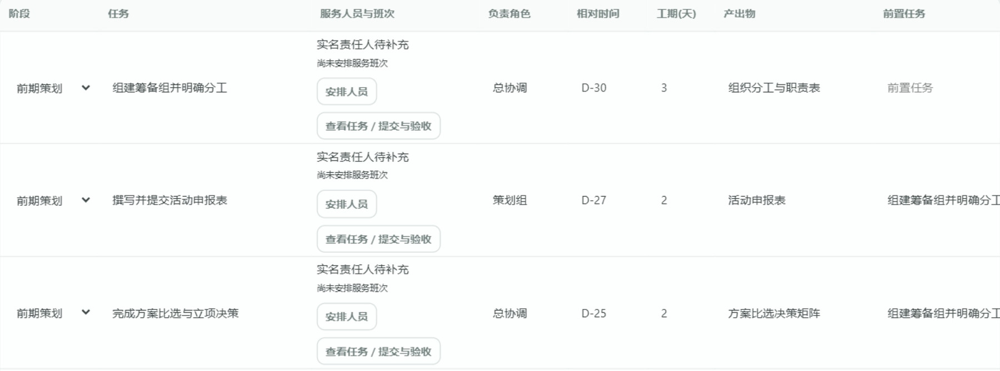
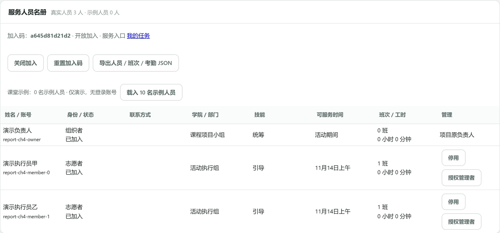
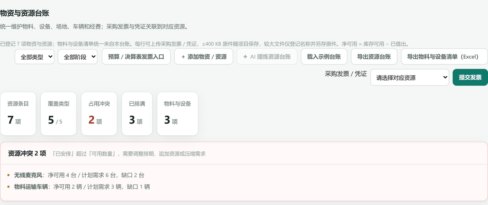
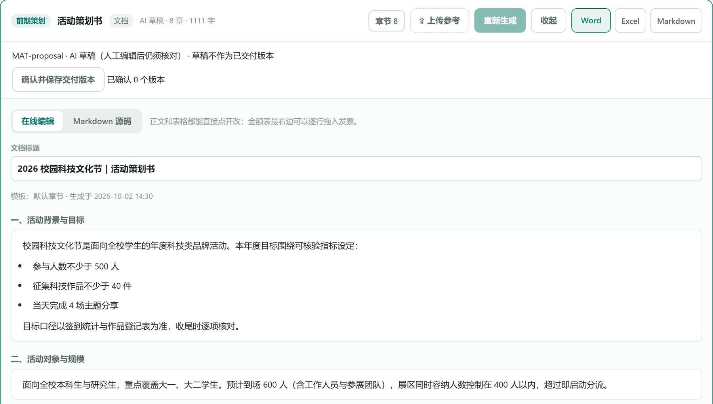
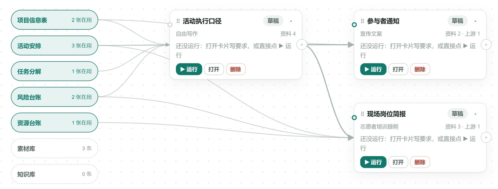
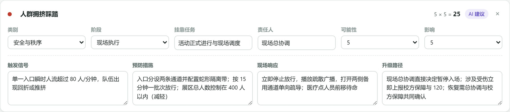
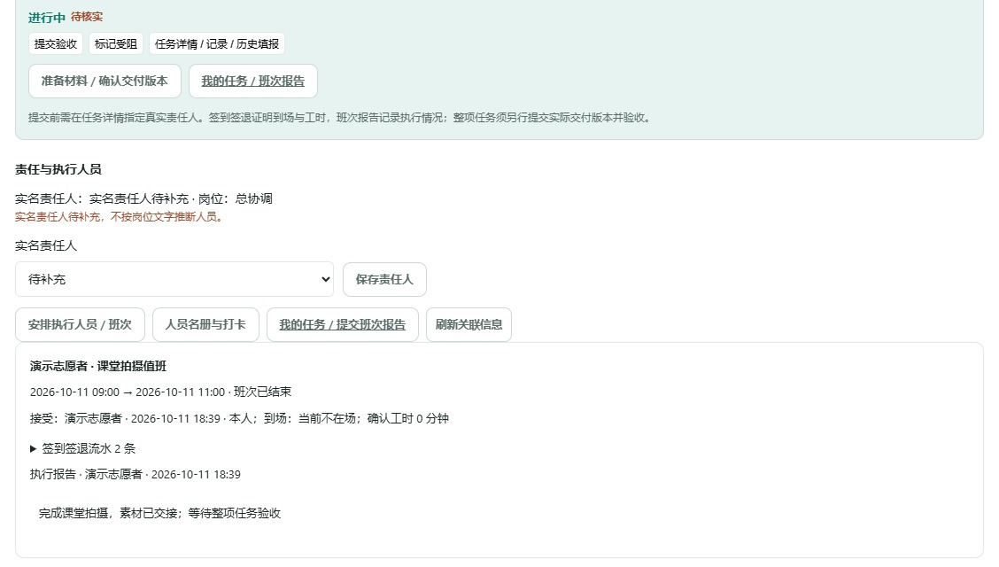

<p align="center">
  
</p>

<p align="center">
  <a href="https://github.com/user-lqt/structured-thinking-workbench/tree/v1.0.0"></a>
  <a href="https://nodejs.org/"></a>
  
  
</p>

<p align="center"><strong>全周期有行动 · 过程有材料 · 风险有预案</strong></p>

<p align="center">
  <a href="#实际界面">实际界面</a> ·
  <a href="#快速开始">快速开始</a> ·
  <a href="#结构化思维如何落地">结构化方法</a> ·
  <a href="#文档与交付物">文档与交付物</a>
</p>

---

校园活动工作台面向迎新、科技文化节、竞赛、运动会等活动，把**项目事实、任务、人员、资源、风险与材料**放在同一操作空间中。组织者统筹项目，成员按班次执行，参与者通过手机填写；AI 辅助制作成果，使用者核对并确认交付。

本项目为《多模态 AI 与结构化思维导论》课程作品，当前版本为 **v1.0 正式版**。

## 工作台能做什么

| 能力 | 主要操作 | 对应成果 |
| :--- | :--- | :--- |
| **项目与策划** | 注册登录，创建、复制、归档活动；维护事实与日程，按统一标准比较方案 | 项目信息表、活动安排、方案比选依据 |
| **计划与协作** | 四阶段任务分解、甘特图、前置依赖、实名责任、邀请权限与版本核对 | 任务清单、分工表、阶段检查点 |
| **人员与资源** | 人员名册、多人班次、时间与技能校验；统一库存、需求和采购凭证 | 排班表、资源缺口、个人执行记录 |
| **AI 与过程材料** | 资料引用、参考模板、卡片工作流；生成、编辑、确认版本与导出 | 内置 **21 类材料**，支持自定义产出 |
| **现场与风险** | 手机报名、签到签退、班次报告；风险评分、分级预案与场景演练 | 报名考勤、应急处置卡、演练记录 |
| **验收与收尾** | 提交实际材料版本，组织者验收或退回；费用、物资与文件归档 | 交付快照、决算、复盘、可复用项目包 |

## 实际界面

以下为工作台实际运行截图，使用校园科技文化节示例。点击图片可查看大图。

### 01 · 从项目入口到执行计划

<table>
  <tr>
    <td width="50%" valign="top">
      <strong>个人项目库</strong><br>
      <sub>创建、打开、复制与归档活动，一场活动一份项目空间。</sub><br><br>
      <a href="docs/assets/readme/projects.jpg"></a>
    </td>
    <td width="50%" valign="top">
      <strong>全周期任务</strong><br>
      <sub>把阶段、责任、期限、依赖和成果落实到任务表。</sub><br><br>
      <a href="docs/assets/readme/tasks.jpg"></a>
    </td>
  </tr>
</table>

### 02 · 人员安排与资源保障

<table>
  <tr>
    <td width="50%" valign="top">
      <strong>人员与班次</strong><br>
      <sub>任务关联实名人员，班次分别接受、打卡和提交报告。</sub><br><br>
      <a href="docs/assets/readme/personnel.jpg"></a>
    </td>
    <td width="50%" valign="top">
      <strong>统一资源台账</strong><br>
      <sub>核对库存与需求，在执行前发现设备和物料缺口。</sub><br><br>
      <a href="docs/assets/readme/resources.jpg"></a>
    </td>
  </tr>
</table>

### 03 · AI 材料与资料引用

<table>
  <tr>
    <td width="50%" valign="top">
      <strong>材料编辑与版本确认</strong><br>
      <sub>草稿在线修订，确认后交付；支持 Word、Excel、Markdown 导出。</sub><br><br>
      <a href="docs/assets/readme/materials.jpg"></a>
    </td>
    <td width="50%" valign="top">
      <strong>卡片工作流</strong><br>
      <sub>选择项目事实和资料，让上游结果成为下游生成的依据。</sub><br><br>
      <a href="docs/assets/readme/workflow.jpg"></a>
    </td>
  </tr>
</table>

文字使用 **DeepSeek**，宣传图像使用 **GPT-image2**。材料按“选定依据 → 生成草稿 → 人工修订 → 确认版本 → 导出与验收”推进。

### 04 · 风险有响应，交付有依据

**分级风险与应急处置** · 可能性 × 影响评估，进一步明确触发信号、预防措施、现场响应与升级路径。

[](docs/assets/readme/risk.jpg)

<details>
<summary><strong>查看任务交付与验收界面</strong></summary>

成员提交已确认的材料版本，组织者验收或退回；执行报告与材料快照共同提供核对依据，后续编辑保留历史验收引用。

[](docs/assets/readme/delivery.jpg)

</details>

## 一场活动怎样推进

| 01 · 前期策划 | 02 · 活动筹备 | 03 · 现场执行 | 04 · 收尾归档 |
| :--- | :--- | :--- | :--- |
| 明确目标与事实<br>比较方案、拆解任务 | 宣传报名、人员排班<br>核对物资、准备预案 | 签到签退、记录过程<br>跟踪任务、响应变化 | 验收成果、核对费用<br>复盘归档、复用项目 |
| 策划书 · 预算 · 分工 | 海报 · 物料 · 排班 | 执行手册 · 考勤 · 记录 | 决算 · 复盘 · 档案 |

**统一事实、协作权限、资料引用和风险评估贯穿四个阶段。** 每项任务都有责任人、期限和交付要求，每个阶段都有可核对的检查点。

## 结构化思维如何落地

| 方法 | 工作台中的操作 | 形成的依据 |
| :--- | :--- | :--- |
| **SPIN** | 从组织背景、难点和影响推导需求 | 信息同步、责任衔接、风险管理目标 |
| **MECE / 逻辑树** | 按过程划分四阶段，再展开任务并设置依赖 | 明确的任务边界与完整工作清单 |
| **5W2H** | 补齐做什么、为什么、谁负责、何时何地、怎样做、需要多少资源 | 项目字段、实名分工、班次与资源条件 |
| **加权决策矩阵** | 候选方案按相同维度和权重评分 | 可查看的分数、理由和方案选择 |
| **ALIGN / RTGO** | 规定 AI 的目标、依据、规则、角色与输出 | 使用共同事实、保留待确认项的材料草稿 |
| **PDCA** | 制定计划、执行和演练、检查验收、修订并归档 | 反馈记录、稳定交付版本与复盘成果 |

## 快速开始

### 1. 启动工作台

安装 **[Node.js 18 或更高版本](https://nodejs.org/)**，下载仓库后在根目录双击 **`start.bat`**。Windows 下也可以从命令行启动：

```powershell
git clone https://github.com/user-lqt/structured-thinking-workbench.git
cd structured-thinking-workbench
node workbench/demo2/tools/start-local.mjs
```

浏览器访问 **[http://127.0.0.1:4175/](http://127.0.0.1:4175/)**。项目无需构建或额外安装运行依赖；使用期间保持启动窗口运行，结束时按 `Ctrl+C`，Windows 下也可双击 `stop.bat`。

### 2. 创建你的第一个活动

1. 注册或登录，组织者进入个人项目库。
2. 创建活动，或从“帮助与数据”载入校园科技文化节示例。
3. 按填写路线图维护项目事实、任务、人员资源和风险。
4. 生成或编辑材料，确认交付版本，再提交任务验收。

### 3. 启用 AI

把 [.env.example](.env.example) 复制为仓库根目录的 `.env`，填写自己的密钥后重启服务：

```dotenv
DEEPSEEK_API_KEY=你的文本服务密钥
DEEPSEEK_MODEL=deepseek-chat
YOSHUB_API_KEY=你的图像服务密钥
YOSHUB_API_BASE=https://api.yoshub.com
YOSHUB_IMAGE_MODEL=gpt-image-2
```

文本与图像服务可分别配置。手工编辑、项目管理和文件导出可直接使用。

### 4. 邀请成员协作

组织者创建项目邀请，成员按查看或编辑权限进入。电脑与手机通过可达地址访问同一服务；同一网络使用局域网地址，跨网络使用 HTTPS 隧道或 Node 托管服务。具体配置、保存与备份步骤见[运维指南](deliverables/用户手册/运维指南.pdf)。

## 文档与交付物

| 想了解什么 | 入口 |
| :--- | :--- |
| **如何使用** | [用户手册 PDF](deliverables/用户手册/用户手册.pdf) · [可编辑说明](workbench/demo2/docs/使用说明.md) |
| **如何部署和维护** | [运维指南 PDF](deliverables/用户手册/运维指南.pdf) · [可编辑说明](workbench/demo2/docs/运维指南.md) |
| **设计与建设过程** | [总结报告 PDF](deliverables/总结报告/总结报告.pdf) · [TeX 源文件](deliverables/总结报告/总结报告.tex) |
| **课堂汇报** | [汇报 PDF](deliverables/汇报PPT/校园活动工作台汇报.pdf) · [图片型 PPT](deliverables/汇报PPT/校园活动工作台汇报_图片版.pptx) · [单文件 HTML](deliverables/汇报PPT/校园活动工作台汇报.html) |
| **讲述准备** | [讲稿 PDF](deliverables/汇报PPT/校园活动工作台汇报讲稿.pdf) · [Markdown](deliverables/汇报PPT/校园活动工作台汇报讲稿.md) |
| **功能与开发细节** | [功能文档](workbench/demo2/README.md) · [截图与验证记录](deliverables/总结报告/验证与截图记录.md) |

<details>
<summary><strong>软件验证与源码导航</strong></summary>

正式版功能基线的离线回归覆盖 **38 个模块、1044 项断言，失败 0 项**；共享、权限、人员排班、任务交付和浏览器操作另有专项检查，详见[验证记录](deliverables/总结报告/验证与截图记录.md)。

本地运行离线自测：

```bash
node workbench/demo2/tools/selftest.mjs
```

```text
structured-thinking-workbench/
├── start.bat / stop.bat     Windows 启动与停止入口
├── .env.example            AI 与服务配置示例
├── workbench/demo2/        正式版应用、服务与测试
├── docs/assets/readme/     首页封面与实际界面截图
└── deliverables/           报告、汇报、用户与运维文档
```

</details>

<p align="center">
  <sub>张敬宇 · 刘秋彤 · 王梓安 · 胡辰凯<br>《多模态 AI 与结构化思维导论》课程项目</sub>
</p>
