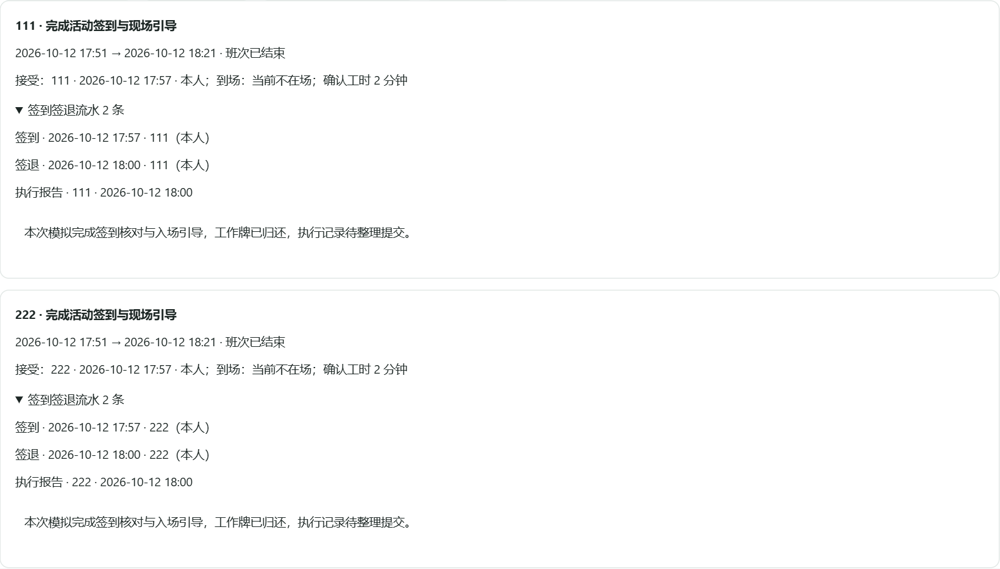
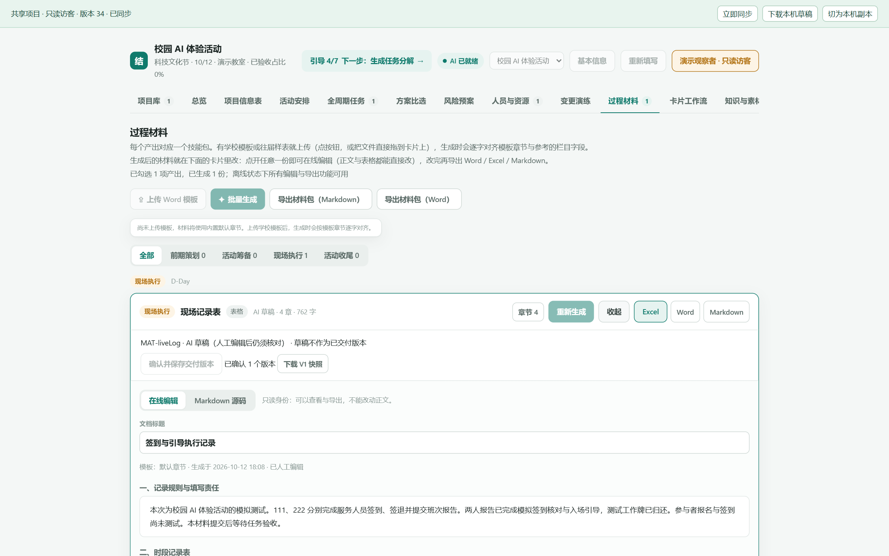
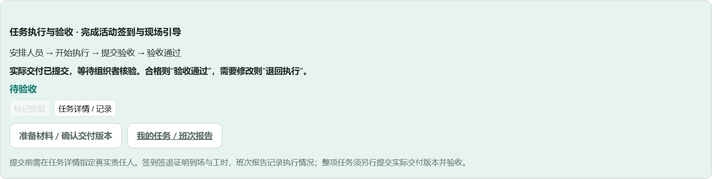
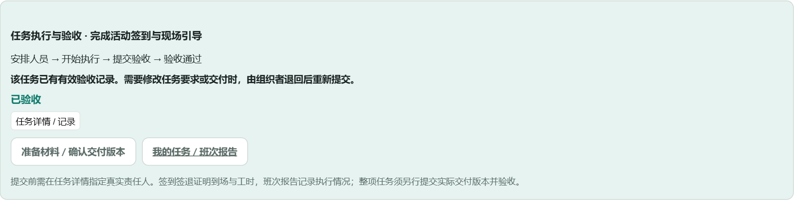
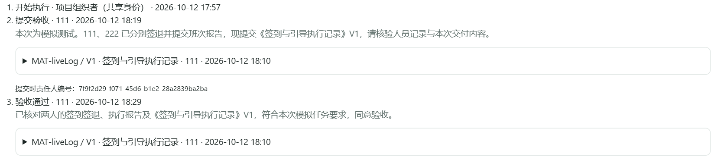

# 校园 AI 体验活动：PPT 截图索引

2026-10-12 从本机运行中的 demo2 实际页面截取。本组截图使用独立只读会话查看用户的测试项目，显示名“演示观察者”。灰色按钮体现只读身份，不表示组织者无法操作。图片没有修改任务状态或伪造正文。

这是模拟活动的结果取证；完整从登录到归档的操作截图将在本轮结束后另用独立演示项目制作。以下序号是截图编号，不是全部业务步骤编号。

| 图片 | 建议 PPT 讲述 | 使用建议 |
| --- | --- | --- |
| [01：任务人员与交付全貌](01-待验收-任务人员与交付全貌.png) | 一项任务能查到责任人、两名执行人员、班次报告、提交人和实际交付版本 | 长图适合备查或裁成上下两部分，避免整张缩小后文字难读 |
| [02：两人的签到签退与报告](02-两名人员-签到签退与执行报告.png) | 多名执行人员各有独立班次及签到签退流水 | 接近横版比例，适合 PPT 单页展示 |
| [03：材料草稿与已确认 V1](03-材料草稿与已确认V1.png) | AI 草稿经人工核对后保存交付版本，当前已有 1 个确认版本 | 保留了项目名称、导航及材料编辑上下文 |
| [04：任务提交后待验收](04-任务已提交-等待组织者验收.png) | 提交完成后进入待验收，由组织者作出核验结论 | 与 05 并列展示状态变化 |
| [05：任务验收通过](05-任务验收通过.png) | 有效验收操作后，任务才进入“已验收” | 与 04 尺寸一致，适合前后对比 |
| [06：验收人、结论及 V1 绑定](06-验收人结论与V1绑定.png) | 同一任务记录开始、提交、验收，实际交付版本可追溯 | 对应讲述“谁执行、提交什么、谁验收” |

## 02：两名人员各自留下执行记录

## 03：人工核对材料，保存实际交付版本

## 04：任务提交后等待验收

## 05：任务验收通过

## 06：验收人、结论和版本绑定

截图中工时按界面显示为 2 分钟；准确的签到至签退时间差见流程记录。01—04 保留验收前的历史节点，05—06 为验收后的新节点。材料中的未填写表格、尚未测试的参与者签到都保留真实情况。
